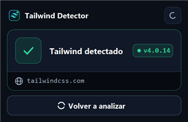
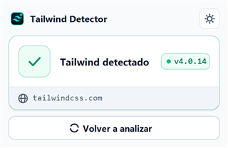

# Tailwind Detector

> Extensión de Chrome que detecta automáticamente si un sitio usa Tailwind CSS, muestra la versión en el icono y en un panel Inspector HUD en tiempo real.

[](LICENSE.md)
[](https://github.com/GallitoMZ/tailwind-detector/releases)
[](https://github.com/GallitoMZ/tailwind-detector/stargazers)

[](https://chromewebstore.google.com/detail/ekhcfihiokhafofblckaccfeaefljdli)

<p align="center">
  
  &nbsp;&nbsp;
  
</p>

## Características

- 🔍 **Detección automática y badge en el icono** — el icono se enciende y muestra la versión detectada (`v4.0`, `v3.4`, `v4`) en la barra de Chrome sin acciones manuales
- 🏷️ **Versión exacta** — muestra `v3.4.17`, `v4.0.14`, etc. con tipografía tabular cuando el CSS conserva los comentarios del compilador o URL de CDN
- ✨ **Soporte completo v3 y v4** — reconoce las firmas nuevas (`@theme`, `@utility`, `@custom-variant`, `@property --tw-*`) y las clásicas (`--tw-*`)
- 🖥️ **Interfaz Inspector HUD (claro/oscuro)** — visor de diagnóstico de alto contraste con barra de dominio empotrada que se adapta al tema del sistema o selección manual
- ⚡ **Rápido y ligero** — fetch paralelo con priorización inteligente y caché por sesión (`chrome.storage.session`)
- 🔒 **Sin telemetría y permisos mínimos** — todo el análisis ocurre 100% localmente en tu navegador
- 🌐 **Inglés y español** — detecta el idioma del navegador automáticamente

## Instalación

### Desde la Chrome Web Store

[](https://chromewebstore.google.com/detail/ekhcfihiokhafofblckaccfeaefljdli)

### Modo desarrollador

1. Clona el repo: `git clone https://github.com/GallitoMZ/tailwind-detector.git`
2. Abre `chrome://extensions`
3. Activa el **Modo desarrollador** (arriba a la derecha)
4. Click en **Cargar descomprimida** → selecciona la carpeta `src/`

## Cómo funciona

La extensión analiza las hojas de estilo de la página buscando firmas únicas de Tailwind:

| Firma | Versión | Confiabilidad |
|-------|---------|---------------|
| Comentario `/*! tailwindcss v... */` | Exacta | Alta |
| `@property --tw-*` | v4 | Alta |
| `@theme`, `@utility`, `@custom-variant` | v4 | Alta |
| Tokens `--color-*`, `--spacing-*`, `--shadow-*`, `--breakpoint-*` | v4 | Media |
| `--tw-*` sueltos | v3 | Media |
| Script del CDN Play (`cdn.tailwindcss.com`) | v3 | Alta |

Si el comentario no aparece en el CSSOM (los navegadores lo descartan), consulta el CSS crudo desde el `href` del `<link>` para extraer la versión exacta.

## Stack

- Manifest V3
- Vanilla HTML, CSS y JavaScript (sin build step, sin dependencias externas)
- Chrome APIs: `chrome.action`, `chrome.storage`, `chrome.runtime`, `chrome.tabs`, `chrome.i18n`

## Estructura

```
src/
├── _locales/
│   ├── en/messages.json   # English (default)
│   └── es/messages.json   # Español
├── manifest.json          # Configuración de la extensión (MV3)
├── background.js          # Service worker (icono, badge de versión y caché por pestaña)
├── content.js             # Script inyectado (detección síncrona y asíncrona)
├── popup.html/css/js      # Interfaz Inspector HUD del popup
└── icons/                 # Iconos activos/inactivos en 16, 48 y 128px
```

## Contribuir

Los PRs son bienvenidos. Casos donde ayuda mucho contribuir:

- Sitios donde la detección falla (abre un issue con la URL y qué esperabas)
- Nuevas firmas de futuras versiones de Tailwind
- Mejoras de accesibilidad en el popup
- Traducciones a nuevos idiomas

## Privacidad

Cero recolección de datos. Detalles en [PRIVACY.md](PRIVACY.md).

## Licencia

MIT © [GallitoMZ](https://github.com/GallitoMZ)